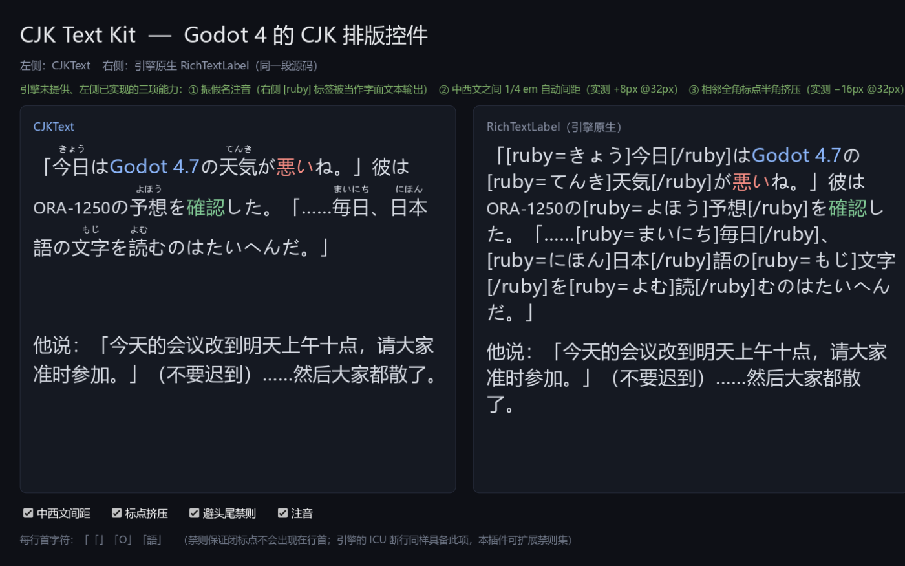

# CJK Text Kit for Godot 4

[](https://godotengine.org)
[](addons/cjk_text/LICENSE.md)
[](https://github.com/Heand-Broken/cjk-text-kit/releases/tag/v1.0.0)

**The CJK typography layer Godot never shipped.**

A text control for Chinese, Japanese and Korean games that adds the parts
of CJK typography Godot does not provide: ruby annotations with automatic
headroom, a quarter-em gap between CJK and Latin text, and half-width
squeezing for adjacent punctuation.



> The user-facing documentation lives in
> [`addons/cjk_text/README.md`](addons/cjk_text/README.md). This file
> describes the repository layout and the development workflow.

---

## Download

* **Plugin** — [`cjk-text-kit-v1.0.0.zip`](https://github.com/Heand-Broken/cjk-text-kit/releases/download/v1.0.0/cjk-text-kit-v1.0.0.zip)
* **Runnable demo** — [`cjk-text-kit-demo-v1.0.0.zip`](https://github.com/Heand-Broken/cjk-text-kit/releases/download/v1.0.0/cjk-text-kit-demo-v1.0.0.zip)

Also available on itch.io.

---

## Why this exists

Measured on **Godot 4.7.2** with a 32 px CJK font:

| Capability | Engine | This addon |
|---|---|---|
| Ruby / furigana | `[ruby=かんじ]漢字[/ruby]` is emitted as **literal text** | Rendered above the base with automatic headroom |
| CJK ↔ Latin gap | `測試AB` = 106.00 px, i.e. **0 px** | **8.00 px** (a quarter em) |
| Punctuation squeeze | `。` always takes a full **32.00 px** em | **−16.00 px** when adjacent |

The engine's own line breaker is *not* the problem: it follows the Unicode
line breaking algorithm, so closing marks already never start a line and
Latin words are already kept whole. The gap is specifically in the
typographic layer, and that is what this project fills.

Reproduce the numbers yourself:

```bash
godot --headless --path . --script tests/verify_features.gd
```

---

## Repository layout

```
addons/cjk_text/          The shipped plugin. This is what buyers download.
  cjk_text.gd             The CJKText control.
  cjk_layout.gd           Line breaking, ruby geometry, spacing, squeezing.
  cjk_parser.gd           Markup parsing and typesetting splits.
  cjk_metrics.gd          Character classification and kinsoku sets.
  cjk_run.gd              A styled, measured fragment of text.
  cjk_fonts.gd            System font resolution for CJK.
  cjk_text_plugin.gd      Editor plugin entry point.
  plugin.cfg              Plugin manifest.
  README.md               User documentation, shipped with the addon.
  CHANGELOG.md            Release notes.
  LICENSE.md              End user licence.

demo/                     Interactive demo, also used to produce screenshots.
docs/
  cover/                  Scene that renders the itch.io cover image.
  screenshots/            Generated images.
  itch_listing.md         Store page copy, pricing and promotion plan.

tests/
  test_runner.gd          Headless test suite (61 checks).
  verify_features.gd      Measures the addon against the engine's breaker.
  scan_kinsoku.gd         Exhaustive kinsoku comparison over many widths.
```

## Development

The repository is a Godot project. Open it in the editor, or run it
headless.

```bash
# Run the demo
godot --path .

# Run the test suite
godot --headless --path . --script tests/test_runner.gd

# Measure the features against the engine's own line breaker
godot --headless --path . --script tests/verify_features.gd

# Regenerate the store images
godot --path . --resolution 1400x900 -- --screenshot
godot --path . res://docs/cover/cover.tscn -- --cover
```

The test suite exits with a non-zero status on failure, so it can be used
directly as a CI step.

## Publishing

1. Copy `addons/cjk_text/` into the zip that is uploaded to the store.
2. Follow `docs/itch_listing.md` for the page copy, the pricing ladder, the
   promotion plan and an honest revenue model.
3. Bump the version in `addons/cjk_text/plugin.cfg` and add an entry to
   `addons/cjk_text/CHANGELOG.md`.

## Compatibility

Verified on **Godot 4.7.2** and **Godot 4.7 stable**, where the full test
suite passes on both. The addon only uses long-standing APIs, so earlier
4.x releases are expected to work but are not verified.

## Licence

The addon is sold under the end user licence in
[`addons/cjk_text/LICENSE.md`](addons/cjk_text/LICENSE.md).
