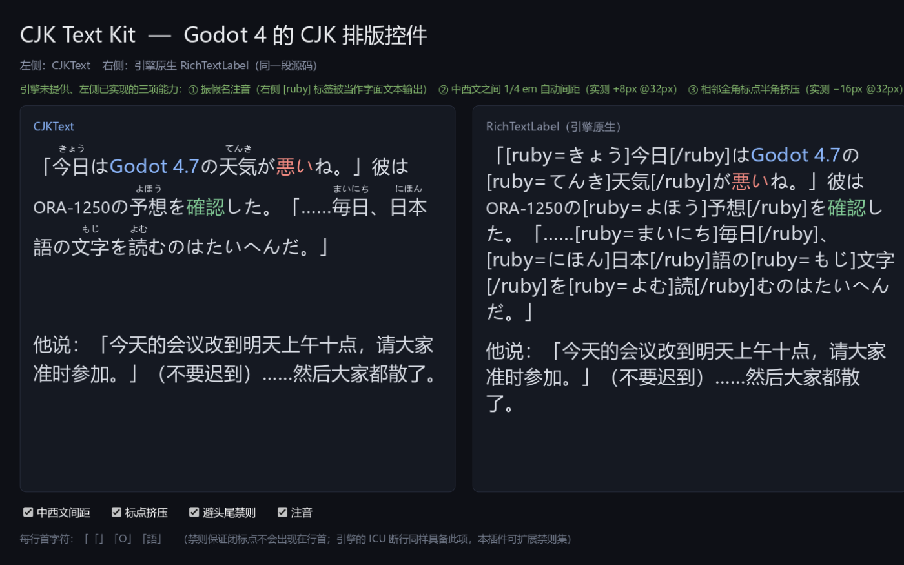

# CJK Text Kit for Godot 4

**Godot 从未提供的 CJK 排版层。**

一个面向中、日、韩游戏开发者的文本控件，补上引擎缺失的排版能力：带
自动行高适配的振假名注音、中日文与西文之间的四分之一字宽间距，以及
相邻全角标点的半角挤压。



> 完整英文文档见 [`addons/cjk_text/README.md`](addons/cjk_text/README.md)。
> 本文件是给中文使用者的快速说明。

---

## 引擎到底缺什么

以下数据在 **Godot 4.7.2** 上用 32px CJK 字体实测得出，可用仓库里的
脚本复现：

| 能力 | 引擎原生 | 本插件 |
|---|---|---|
| 振假名注音 | `[ruby=かんじ]漢字[/ruby]` 被当成**字面文本**原样输出 | 注音绘制在汉字上方，行高自动适配 |
| 中西文间距 | `測試AB` 宽 106.00px，间隔 **0px** | **8.00px**（四分之一字宽） |
| 标点挤压 | `。` 永远占满 **32.00px** 整格 | 相邻时压缩 **16.00px** |
| 西文单词完整性 | 不拆词 | 不拆词 |

需要说明的是：**引擎自身的断行没有问题**。它遵循 Unicode 行分割算法，
闭标点不会出现在行首，西文单词也不会被拆开。这个插件补的是排版层，
不是去修断行。

```bash
godot --headless --path . --script tests/verify_features.gd   # 复现上表
```

---

## 安装

1. 解压 `addons/cjk_text/` 到项目根目录。
2. 在 *项目 → 项目设置 → 插件* 中启用 **CJK Text**。
3. 添加 `CJKText` 节点，或从脚本实例化。

```gdscript
var label := CJKText.new()
label.font = CJKFonts.create_system_font()   # 不需要附带字体文件
label.font_size = 28
label.ruby_font_size = 14
label.text = "「[ruby=きょう]今日[/ruby]は良い天気ですね。」"
add_child(label)
```

### 字体

中日韩字体体积巨大且常带分发限制，所以插件**不附带任何字体**。两种用法：

```gdscript
label.font = CJKFonts.create_system_font()   # 调用玩家系统里已装的字体
label.font = CJKFonts.create_system_font(PackedStringArray(["Noto Sans JP"]))
label.font = load("res://fonts/MyFont.ttf")   # 或用你自己有权分发的字体
```

`CJKFonts.detect_installed()` 会列出本机可用的 CJK 字族，
`CJKFonts.has_cjk_support()` 判断系统能否显示汉字。

---

## 标记语法

| 标记 | 效果 |
|---|---|
| `[b]…[/b]` | 加粗（用合成加粗，不需要额外的粗体字体文件） |
| `[i]…[/i]` | 斜体 |
| `[u]…[/u]` | 下划线 |
| `[color=#ff8800]…[/color]` | 颜色，支持 `#rgb` / `#rrggbb` / `#rrggbbaa` 与内置色名 |
| `[font_size=28]…[/font_size]` | 指定字号 |
| `[ruby=かんじ]漢字[/ruby]` | 振假名注音，`[rb=…]` 为别名 |

解析器刻意做得宽容：未知标签按原样保留，多余的闭标签直接忽略，未闭合的
标签在字符串末尾自动闭合。从存档里读出来的对话不会把排版搞崩。

---

## 已知限制

- **不支持竖排。** Godot 文本服务器报告 `FEATURE_VERTICAL_LAYOUT = false`，
  竖排需要自己实现字形布局。
- `CJKText` 自己排版，因此不支持 `RichTextLabel` 的引擎专有标记
  （`[url]`、`[img]`、`[table]`、动画特效）。
- 注音底文不跨行拆分，过长的底文在窄控件里会溢出。
- 不支持基于 `visible_characters` 的打字机效果。

## 兼容性

在 **Godot 4.7.2** 与 **Godot 4.7 stable** 上验证，完整测试套件均通过。
插件只使用 Godot 4.0 起就存在的 API，更早的 4.x 预计可用但**未经验证**。

## 许可

见 [`addons/cjk_text/LICENSE.md`](addons/cjk_text/LICENSE.md)：一名开发者
一份许可，商业与非商业项目不限数量，无版税、无收入上限、无席位费。
