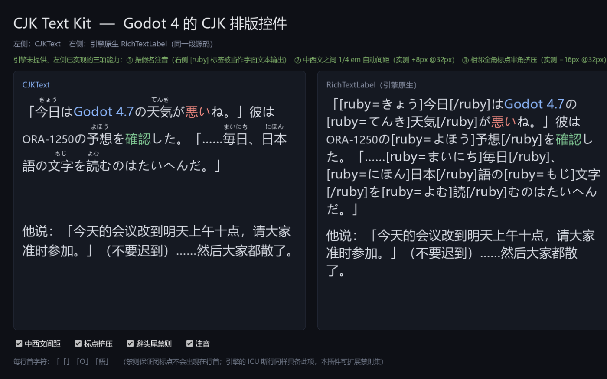
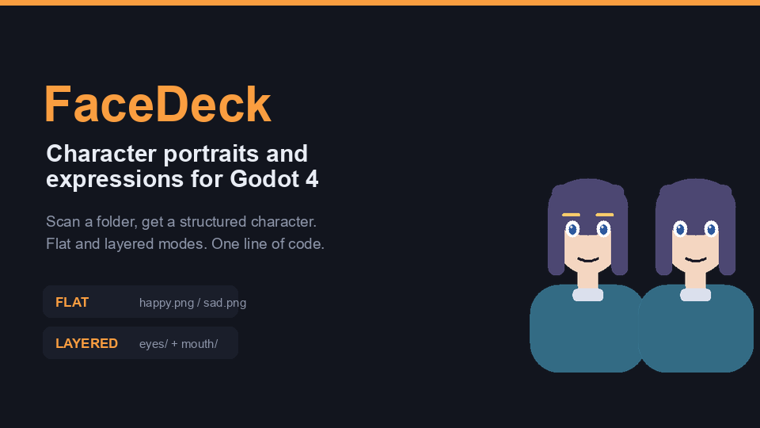

# CJK Text Kit for Godot 4

**The CJK typesetting layer Godot never shipped.**

`CJKText` is a text control for Chinese, Japanese and Korean games. It adds
the parts of CJK typography that the engine does not provide, and it does
them properly: ruby annotations with automatic headroom, a quarter-em gap
between CJK and Latin text, and half-width squeezing for adjacent
punctuation.



---

## What the engine is missing

The measurements below were taken on **Godot 4.7.2** with a 32 px CJK font.
They are reproducible with the script shipped in `tests/verify_features.gd`.

| Capability | Godot 4.7.2 | CJK Text Kit |
|---|---|---|
| Ruby / furigana annotations | `[ruby=かんじ]漢字[/ruby]` is emitted as **literal text** | Rendered above the base, with automatic line height |
| CJK ↔ Latin spacing | `測試AB` measures **106.00 px** = `測試` + `AB`, i.e. **0 px gap** | **8.00 px** gap (a quarter em at 32 px) |
| Punctuation squeezing | `。` occupies a full **32.00 px** em | Adjacent marks compress by half an em, **−16.00 px** |
| Latin word integrity | Never split | Never split |

Godot's own line breaker is good: it follows the Unicode line breaking
algorithm, so closing marks already never start a line and Latin words are
already kept whole. CJK Text Kit keeps that behaviour and lets you extend
the forbidden character set, but it does not claim credit for it.

---

## Features

- **Ruby / furigana** — `[ruby=かんじ]漢字[/ruby]` draws the reading above the
  base text and reserves the vertical space the line needs. Readings are
  centred over their base.
- **Automatic CJK/Latin spacing** — a quarter em is inserted wherever
  Chinese or Japanese text touches a Latin word or a number.
- **Punctuation squeezing** — two adjacent full-width marks of the same
  class compress to half width, so `真的？！」` stops wasting a full em.
- **Kinsoku shori** — closing marks never start a line and opening marks
  never end one, with a configurable extra character set.
- **Word integrity** — Latin words are never broken across lines unless the
  word is longer than the line itself.
- **Lightweight markup** — `[b]`, `[i]`, `[u]`, `[color=#ff8800]`,
  `[font_size=28]` and `[ruby=…]`. The parser is forgiving: unknown tags are
  kept as text, stray closing tags are ignored, unclosed tags are closed at
  the end of the string.
- **Zero dependencies, zero embedded fonts** — the control ships no font
  binaries and reads nothing from disk.

---

## Installation

1. Copy `addons/cjk_text/` into your project's `addons/` folder.
2. Enable **CJK Text** in *Project → Project Settings → Plugins*.
3. Add a `CJKText` node, or instantiate it from a script.

```gdscript
var label := CJKText.new()
label.font = CJKFonts.create_system_font()
label.font_size = 28
label.ruby_font_size = 14
label.text = "「[ruby=きょう]今日[/ruby]は良い天気ですね。」"
add_child(label)
```

### Fonts

CJK fonts are large and often carry distribution restrictions, so the addon
ships none. Point `font` at a font file you are allowed to ship, or use the
helper to resolve one already installed on the player's system:

```gdscript
label.font = CJKFonts.create_system_font()   # Microsoft YaHei / PingFang / Yu Gothic / ...
label.font = CJKFonts.create_system_font(PackedStringArray(["Noto Sans JP"]))
```

`CJKFonts.detect_installed()` lists the CJK families available on the
current machine, and `CJKFonts.has_cjk_support()` reports whether any of
them can render Han characters.

---

## Markup reference

| Tag | Effect |
|---|---|
| `[b]…[/b]` | Bold. Rendered with a synthetic embolden, so no bold font file is needed. |
| `[i]…[/i]` | Italic. Rendered with a slanted transform. |
| `[u]…[/u]` | Underline. |
| `[color=#ff8800]…[/color]` | Colour. Accepts `#rgb`, `#rrggbb`, `#rrggbbaa` and the named colours listed in `CJKParser.NAMED_COLORS`. |
| `[font_size=28]…[/font_size]` | Explicit pixel size for the enclosed text. |
| `[ruby=かんじ]漢字[/ruby]` | Ruby annotation. `[rb=…]` is accepted as an alias. |

Ruby bases are not split, so the reading always stays centred over the
whole base text.

---

## API

### Properties

| Property | Default | Description |
|---|---|---|
| `text` | `""` | The markup source. |
| `font` | theme default | Font for the body text. |
| `font_size` | `24` | Body font size in pixels. |
| `ruby_font` | `font` | Font for ruby readings. |
| `ruby_font_size` | `12` | Ruby reading size in pixels. |
| `default_color` | white | Colour used when a run does not specify one. |
| `line_spacing` | `4.0` | Extra space between lines. |
| `ruby_spacing` | `1.0` | Gap between a reading and the baseline. |
| `alignment` | left | Horizontal alignment of each line. |
| `cjk_latin_spacing` | `true` | Insert the quarter-em CJK/Latin gap. |
| `squeeze_punctuation` | `true` | Compress adjacent full-width punctuation. |
| `kinsoku` | `true` | Apply line start / line end forbidden characters. |
| `extra_line_start_forbidden` | `""` | Extra characters that may not start a line. |
| `extra_line_end_forbidden` | `""` | Extra characters that may not end a line. |
| `autowrap` | `true` | Wrap at the control width. |

### Methods

| Method | Description |
|---|---|
| `set_text(value)` | Replace the markup and re-typeset. |
| `get_plain_text()` | The text with every tag removed. |
| `get_content_height()` | Height needed to display the current text. |
| `get_line_count()` | Number of laid out lines. |
| `get_line_text(index)` | The text of a laid out line, tags removed. |

### Signals

| Signal | Description |
|---|---|
| `text_relaid_out` | Emitted after the text has been re-typeset. |

### Static helpers

| Call | Description |
|---|---|
| `CJKParser.parse(source)` | Parse markup into runs. |
| `CJKParser.strip_tags(source)` | Remove every tag from a string. |
| `CJKParser.parse_color(value)` | Resolve a colour literal. |
| `CJKFonts.create_system_font(extra)` | Build a system font covering CJK. |
| `CJKFonts.detect_installed()` | List installed CJK families. |
| `CJKFonts.has_cjk_support()` | Whether the system can render Han characters. |

---

## Migrating from RichTextLabel

`CJKText` is not a drop-in replacement: it draws its own text instead of
using `RichTextLabel`, so engine specific markup such as `[url]`, `[img]`,
`[table]` and animation effects are not supported. What it offers in return
is typography the engine cannot do at all.

To keep a mixed document, place a `CJKText` next to the `RichTextLabel`
rather than trying to make one control do both.

---

## Compatibility

- **Verified on Godot 4.7.2 and 4.7 stable** (Windows). The full test
  suite passes on both.
- The addon only uses APIs that have existed since Godot 4.0, so earlier 4.x
  releases are expected to work, but they are **not verified here**. If you
  are on an older 4.x and something misbehaves, please report it.
- GDScript only. The control is a `Control`, so it works in any node tree.

## Sister product

**FaceDeck** — character portrait and expression management for Godot 4,
from the same author. The two tools cover the two halves of a Japanese or
Chinese visual novel: FaceDeck manages the character art, CJK Text Kit
manages the text. They are sold separately and neither requires the other.



## Licence

See `LICENSE.md`. One licence per developer, unlimited commercial and
non-commercial projects, no royalties and no revenue caps.

## Roadmap

- Vertical text (縦書き). Godot's text server reports
  `FEATURE_VERTICAL_LAYOUT = false`, so this needs its own glyph layout.
- Hanging punctuation, where a mark hangs into the margin instead of
  compressing the line.
- A paragraph-level API with alignment, indentation and text spacing.
