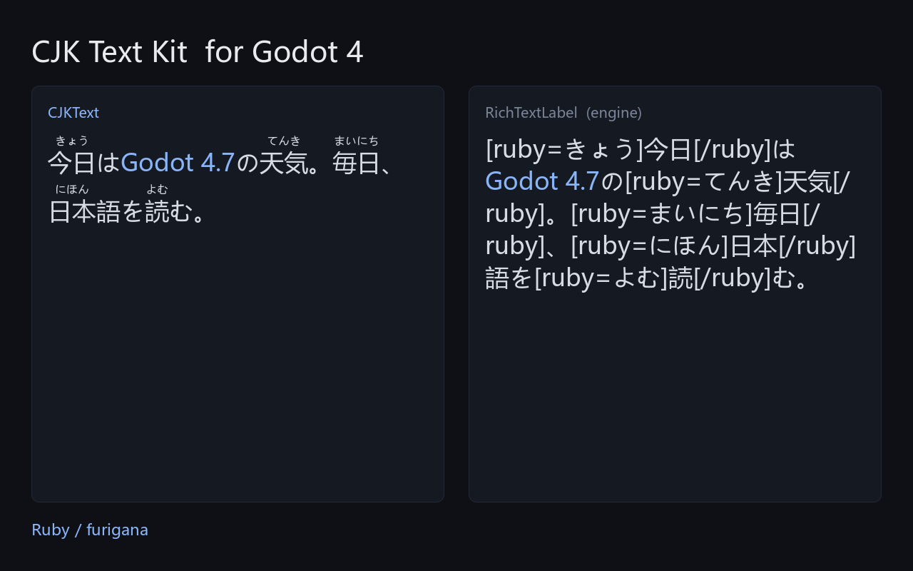

# itch.io page — CJK Text Kit

Copy-paste content for the store page. The image placeholders point at the
files in this folder; after uploading them to itch, replace the paths with
the URLs itch gives you, or insert the images through the page editor
(it rewrites the URLs for you).

**Page title**

```
CJK Text Kit for Godot 4 — Furigana, Kinsoku & CJK Typography
```

**Short description** (the one line next to the price)

```
The CJK typography layer Godot never shipped.
```

---

## Description

```markdown
**Godot's RichTextLabel cannot typeset CJK text. CJK Text Kit can.**

On Godot 4.7.2, `[ruby=かんじ]漢字[/ruby]` is not a tag. It comes out of the
engine as the literal string `[ruby=かんじ]漢字[/ruby]`, and the line breaks
around it are a mess.



That is the whole problem in one screenshot. The left panel is CJK Text
Kit, the right panel is the stock `RichTextLabel`, and both are rendering
exactly the same source string.

---

### ✨ Ruby / furigana annotations

`[ruby=かんじ]漢字[/ruby]` draws the reading above the base text, centres it
over the base, and reserves the vertical space the line needs. No manual
line-height tweaking, no nested label nodes, no custom portrait script.

### ✨ Automatic CJK/Latin spacing

A quarter em is inserted wherever Chinese or Japanese text touches a Latin
word or a number.

Measured on Godot 4.7.2 at 32 px:

| | Engine | CJK Text Kit |
|---|---|---|
| `測試AB` | 106.00 px | **114.00 px** |
| gap between `測試` and `AB` | 0 px | **8.00 px** (0.25 em) |

### ✨ Punctuation squeezing

Adjacent full-width marks of the same class compress to half width, so
`真的？！」` stops wasting an em-square.

| | Engine | CJK Text Kit |
|---|---|---|
| `。` advance | 32.00 px (full em) | **−16.00 px** when adjacent |

### ✨ Kinsoku shori

Closing marks never start a line and opening marks never end one, with an
extra character set you can configure from the inspector.

To be straight about it: Godot's own line breaker already follows the
Unicode line breaking algorithm, so it already keeps closing marks off the
line start and already keeps Latin words whole. This is not a fix, it is an
explicit guarantee, and it lets you extend the rule set with characters the
algorithm does not know about, such as the Japanese prolonged sound mark.

### ✨ Latin words are never split

`ORA-1250` stays in one piece. Words longer than the line are broken as a
last resort.

---

### 🚀 Install

1. Unzip `addons/cjk_text/` into your project.
2. Enable **CJK Text** in *Project → Project Settings → Plugins*.
3. Add a `CJKText` node.

### 💻 Usage

```gdscript
var label := CJKText.new()
label.font = CJKFonts.create_system_font()   # no font files to ship
label.font_size = 28
label.ruby_font_size = 14
label.text = "「[ruby=きょう]今日[/ruby]は良い天気ですね。」"
add_child(label)
```

No font binary is bundled. CJK fonts are huge and often carry distribution
restrictions, so the addon resolves a family that is already installed on
the player's system, or you point it at a font file you are allowed to
ship.

### 🏷️ Markup

`[b]` `[i]` `[u]` `[color=#ff8800]` `[font_size=28]` `[ruby=かんじ]`

The parser is forgiving on purpose: unknown tags stay as literal text,
stray closing tags are ignored, and unclosed tags are closed at the end of
the string. Dialogue loaded out of a save file will not break the layout.

### ✅ Compatibility

* **Verified on Godot 4.7.2 and 4.7 stable.** The full test suite passes on
  both.
* Earlier 4.x releases are expected to work, but are not verified.
* GDScript only. No dependencies, no autoloads, no project settings
  changes.

### 📜 Licence

One licence per developer. Unlimited commercial and non-commercial projects.
No royalties, no revenue caps, no seat fees. Compiled games can be sold on
any platform without attribution.

### 🗺️ Roadmap

* Vertical text (縦書き). The engine's text server reports
  `FEATURE_VERTICAL_LAYOUT = false`, so it needs its own glyph layout.
* Hanging punctuation, where a mark hangs into the margin instead of
  compressing the line.
* Paragraph alignment, indentation and text spacing.

---

*Also by the author: **FaceDeck**, character portrait and expression
management for Godot 4. The two tools cover the two halves of a Japanese
or Chinese visual novel — FaceDeck manages the character art, CJK Text Kit
manages the text. They are sold separately and neither requires the other.*
```

---

## Files in this folder

| File | Use |
|---|---|
| `cover.png` | Store cover, 630 × 250 |
| `demo.gif` | Animated demo, 760 × 475, about 13 seconds, loops |
| `demo.png` | Static side-by-side comparison, 1280 × 800 |
| `feature-ruby.png` | The furigana comparison, the strongest single image |
| `feature-spacing.png` | CJK/Latin spacing example |
| `feature-squeeze.png` | Punctuation squeezing example |

Upload `demo.gif` as the "embedded file" and put `cover.png` in the cover
slot. The three `feature-*.png` files work well as gallery screenshots.
